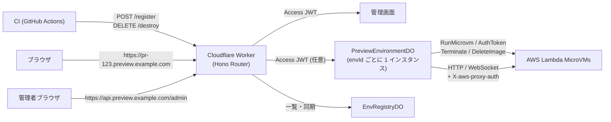

# hatch

[](https://github.com/kiyo-e/hatch/actions/workflows/ci.yml)
[](LICENSE)

[English](README.md) | 日本語

**AWS Lambda MicroVMs** 上のオンデマンド PR プレビュー環境を、**Cloudflare Workers** と **Durable Objects** でオーケストレーションするプロキシ兼ライフサイクル管理基盤です。

MicroVM イメージの ARN を登録するだけで、プレビュー用サブドメイン（`https://pr-123.preview.example.com`）の払い出しから、コールドスタート起動、8 時間寿命のローテーション、JWE プロキシ認証、HTTP / WebSocket の透過プロキシ、PR クローズ時の自動掃除までを一貫して処理します。

## アーキテクチャ



## 主な機能

- **1 環境 = 1 Durable Object**: サブドメイン（例: `pr-123.preview.example.com`）を `idFromName("pr-123")` へ決定的にルーティングし、インメモリロックで同時アクセス時の `RunMicrovm` 多重起動を防止します。
- **8 時間寿命の透過ローテーション**: AWS Lambda MicroVMs の最大寿命（28,800 秒 = 8 時間）に対し **7 時間 45 分** を実効 TTL とし、期限超過時は旧 VM を終了しつつ新しい MicroVM を起動して切り替えます。
- **自己修復プロキシ**: 寿命内で AWS 側の VM が `TERMINATED` / `NOT_FOUND` になった場合や、プロキシ用 JWE トークンが失効（`403`）した場合は、状態確認・再発行・再起動のうえリクエストをリトライします。
- **HTTP / WebSocket 透過プロキシ**: `X-aws-proxy-auth`・`X-aws-proxy-port`・`X-Forwarded-Host`・`X-Forwarded-Proto` を自動付与し、ActionCable などの `Upgrade: websocket` 通信も同じパスで転送します。
- **コールドスタート時のローディング画面**: `COLD_START_LOADING_PAGE=true` の場合、起動中のブラウザアクセス（`Accept: text/html`）には 3 秒自動リロードの軽量 HTML（`503` + `Retry-After: 3`）を即返し、バックグラウンドで起動を完了させます。
- **DO Alarm によるゾンビ掃除**: `register` 時に `ZOMBIE_TTL_DAYS`（既定 14 日）後の Alarm を設定し、PR クローズ Webhook を取りこぼしても自動破棄します。終了・削除に失敗したリソースは削除待ちとして記録し、10 分ごとに Alarm で再試行します。
- **管理画面**: `https://<API_HOSTNAME>/admin` で環境の一覧・状態・削除待ちの確認や手動破棄ができます（Cloudflare Access で保護）。

## クイックスタート（ローカル）

Wrangler を使って手元ですぐに試せます（Node.js のバージョンは [`.nvmrc`](.nvmrc) を参照）。

```bash
npm ci
cp .dev.vars.example .dev.vars
npm run dev
```

`.dev.vars` により `API_HOSTNAME=api.localhost` / `PREVIEW_BASE_DOMAIN=localhost` が有効になり、`wrangler.jsonc` の設定より優先されます。

- **管理画面**: `http://api.localhost:8787/admin`（`localhost` では Access 認証をバイパスします）
- **管理 API**: `http://api.localhost:8787/api/envs/:envId/*`
- **プレビュー URL**: `http://<envId>.localhost:8787`

`.dev.vars.example` のダミー AWS 認証情報のままでも、イメージ登録・一覧・管理画面の動作を確認できます（MicroVM の実起動には本物の AWS 認証情報が必要です）。

型チェックとテストの実行:

```bash
npm run typecheck
npm test
```

## デプロイ手順

### 1. `wrangler.jsonc` の設定

ホスト名ベースでルーティングするため、`workers.dev` とプレビュー URL は無効化しています。[`wrangler.jsonc`](wrangler.jsonc) の `vars` をご自身の環境に合わせて変更し、`routes` のコメントを外して設定してください。

```jsonc
"routes": [
  { "pattern": "api.preview.example.com/*", "zone_name": "example.com" },
  { "pattern": "*.preview.example.com/*", "zone_name": "example.com" }
]
```

### 2. シークレットの登録

`wrangler secret put` で本番用のシークレットを登録します。

```bash
npx wrangler secret put AWS_ACCESS_KEY_ID
npx wrangler secret put AWS_SECRET_ACCESS_KEY
npx wrangler secret put CI_WEBHOOK_SECRET

# 管理画面 (/admin) を使う場合
npx wrangler secret put CF_ACCESS_TEAM_DOMAIN
npx wrangler secret put CF_ACCESS_ADMIN_AUD

# 任意: プレビュー (*.preview.example.com) も Cloudflare Access で保護する場合
npx wrangler secret put CF_ACCESS_AUD
```

### 3. AWS IAM ポリシーの設定

Worker が使用する IAM ユーザーに、以下の最小権限ポリシーを付与してください。

```json
{
  "Version": "2012-10-17",
  "Statement": [
    {
      "Effect": "Allow",
      "Action": [
        "lambda:RunMicrovm",
        "lambda:GetMicrovm",
        "lambda:TerminateMicrovm",
        "lambda:CreateMicrovmAuthToken",
        "lambda:DeleteMicrovmImage"
      ],
      "Resource": "*"
    }
  ]
}
```

### 4. デプロイ

```bash
npm run deploy
```

## 設定リファレンス

### 環境変数（`wrangler.jsonc` の `vars`）

| 変数名 | 必須 | 既定値 | 説明 |
| :--- | :--- | :--- | :--- |
| `AWS_REGION` | はい | `ap-northeast-1` | MicroVM を稼働させる AWS リージョン |
| `APP_TARGET_PORT` | はい | `8080` | MicroVM 内アプリの待受ポート |
| `PREVIEW_BASE_DOMAIN` | はい | `preview.example.com` | プレビュー用ベースドメイン（`<envId>.<PREVIEW_BASE_DOMAIN>`） |
| `API_HOSTNAME` | はい | `api.preview.example.com` | 管理 API（`/api/*`）および管理画面（`/admin`）用ホスト名 |
| `COLD_START_LOADING_PAGE` | いいえ | `true` | 起動中のブラウザアクセスに自動リロード画面（`503`）を返すか |
| `ZOMBIE_TTL_DAYS` | いいえ | `14` | 放置環境を DO Alarm で自動破棄するまでの日数 |
| `AWS_MICROVM_EXECUTION_ROLE_ARN` | いいえ | — | `RunMicrovm` に渡す IAM 実行ロール ARN |
| `AWS_EGRESS_NETWORK_CONNECTORS` | いいえ | — | カンマ区切りの Egress Network Connector ARN |

### シークレット（`wrangler secret put` / `.dev.vars`）

| シークレット名 | 必須 | 説明 |
| :--- | :--- | :--- |
| `AWS_ACCESS_KEY_ID` | はい | AWS IAM アクセスキー ID |
| `AWS_SECRET_ACCESS_KEY` | はい | AWS IAM シークレットアクセスキー |
| `AWS_SESSION_TOKEN` | いいえ | STS 一時認証情報のトークン（本番は長期アクセスキー推奨） |
| `CI_WEBHOOK_SECRET` | はい | `X-CI-Secret` ヘッダーで検証する共有シークレット |
| `CF_ACCESS_TEAM_DOMAIN` | Access 利用時 | Cloudflare Access のチームドメイン（例: `your-team.cloudflareaccess.com`） |
| `CF_ACCESS_ADMIN_AUD` | `/admin` 利用時 | `<API_HOSTNAME>/admin` 用 Access アプリの AUD（未設定時は `503` で拒否） |
| `CF_ACCESS_AUD` | いいえ | プレビュー用 Access アプリの AUD（`CF_ACCESS_TEAM_DOMAIN` も必須） |

> [!NOTE]
> `<API_HOSTNAME>/admin` に Cloudflare Access を設定する際、CI Webhook が `X-CI-Secret` でアクセスできるよう `/api/*` は Access の対象に含めないでください。

## 管理 API

`/api/envs/:envId/*` はすべて `X-CI-Secret` ヘッダーが必須です。`:envId` は有効な DNS ラベル（英小文字・数字・ハイフン、63 文字以内）のみ受け付けます。

### イメージの登録

```bash
curl -X POST "https://api.preview.example.com/api/envs/pr-123/register" \
  -H "Content-Type: application/json" \
  -H "X-CI-Secret: $CI_WEBHOOK_SECRET" \
  -d '{"imageIdentifier":"arn:aws:lambda:ap-northeast-1:123456789012:microvm-image:pr-123"}'
```

互換エイリアスとして `imageId`、任意項目として `imageVersion` も指定できます。

### 状態の確認

```bash
curl "https://api.preview.example.com/api/envs/pr-123/status" \
  -H "X-CI-Secret: $CI_WEBHOOK_SECRET"
```

### 環境の破棄

```bash
curl -X DELETE "https://api.preview.example.com/api/envs/pr-123/destroy" \
  -H "X-CI-Secret: $CI_WEBHOOK_SECRET"
```

稼働中の MicroVM を終了し、イメージと DO ストレージ・Alarm を削除します。AWS 側の削除に一部失敗した場合は `502` を返し、DO Alarm で自動再試行します。

## CI 連携の例（GitHub Actions）

アプリ側リポジトリ向けのワークフロー例を [`examples/github-actions/`](examples/github-actions/) に用意しています。

- [`preview-deploy.yml`](examples/github-actions/preview-deploy.yml): PR 作成・更新時に MicroVM イメージをビルドして登録
- [`preview-cleanup.yml`](examples/github-actions/preview-cleanup.yml): PR クローズ時にプレビュー環境を破棄

両ファイルをアプリ側リポジトリの `.github/workflows/` にコピーし、`API_BASE_URL` と `CI_WEBHOOK_SECRET` シークレットを設定したうえで、イメージビルド処理を実装してください。

## リバースプロキシとフレームワークの注意点

プロキシ時、`hatch` は `X-Forwarded-Host: <envId>.<PREVIEW_BASE_DOMAIN>` と `X-Forwarded-Proto: https` を付与します。一方、アプリ側が受け取る `Host` ヘッダーは MicroVM のエンドポイント（`*.lambda-microvm.<region>.on.aws`）になります。

### Rails の場合

Host authorization と ActionCable の両方で許可が通るよう、`config/environments/production.rb`（または `staging.rb`）に以下を設定してください。

```ruby
# Rails が \A...(:port)?\z で囲むため、正規表現に \A / \z は書かない
config.hosts << /[a-z0-9-]+\.preview\.example\.com/
config.hosts << /[a-z0-9-]+\.lambda-microvm\.[a-z0-9-]+\.on\.aws/

config.action_cable.allowed_request_origins = [%r{\Ahttps://[a-z0-9-]+\.preview\.example\.com\z}]
```

なお、[`wrangler.jsonc`](wrangler.jsonc) では `dev.upstream_protocol` を `https` に設定しており、`wrangler dev` 時に `Origin` / `Referer` が `http://` に書き換えられて CSRF や ActionCable の検証が失敗するのを防いでいます。

## コントリビュート

コントリビューションを歓迎します。開発手順や PR ガイドラインは [CONTRIBUTING.md](CONTRIBUTING.md) をご覧ください。

## ライセンス

[MIT](LICENSE)
